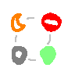

 {:height="32px"} [Is Presence Fixed Yet?](/)

# Presence v2 Hall of Fame

The Presence v2 initiative was made possible by many people over the span of many hours of hard work, so we'd like
to take the time to recognize every contributor who has made this possible.

## Early Days

Presence v2 as a concept came rise from [this conversation in #spec][spec-convo],
of which the following contributed:

* LogN
* charmines
* Andrew Morgan (SCT)
* Cat
* stratself
* gamesguru
* nex (Continuwuity)

## The Proposals

### Primary Proposal Authors

* LogN
* lveneris

### Contributors & Reviewers

* **[Continuwuity]**: nex, Ginger
* **[Nexus Client]**: QuadRadical
* **[Sable Client]**: 7w1, Erwan Leboucher
* Independent: stratself, HarHarLinks, Cat, 31a05b9c, CrazyNicc, gamesguru

## Implementations

### [MSC4495: Selective Presence][MSC4495]

* **[Ruma][ruma-sel-pr]:** LogN, Kévin Commaille, lveneris
* **[Continuwuity][cxy-sel-pr]:** LogN, nex, Ginger, lveneris
* **[Sable][sable-sel]:** Erwan Leboucher

### [MSC4532: Revised Social Presence][MSC4532]

* **[Ruma][ruma-soc-pr]:** LogN, Kévin Commaille, lveneris
* **[Continuwuity][cxy-soc-pr]:** Erwan Leboucher, LogN

### [MSC4559: Sliding Sync Extensions: Presence][MSC4559]

* **[Ruma][ruma-sss-pr]:** LogN, Kévin Commaille

## Special Thanks

* To HarHarLinks, for [MSC4325](https://github.com/matrix-org/matrix-spec-proposals/pull/4325) which heavily
  inspired Selective Presence.
* To vicky, for emotional support & the Presence v2 logo/room icons
* To mangotcf, for emotional support
* To Cat, for work on the Incremental Heartbeat-Assisted Presence draft which inspired Revised Social Presence.

[spec-convo]: https://matrix.to/#/!nD4Jy1hp0We0VmIM9ubjqWLBX_uV8YlTBBPa3a_v2uk/%24pky9awpkMJUWeJPhTjcPaBZ7EPtAQ6rlKWUs9nCx66s?via=zirco.dev&via=matrix.org&via=element.io
[Continuwuity]: https://continuwuity.org/
[Nexus Client]: https://matrix.to/#/#nexus:federated.nexus
[Sable Client]: https://sable.moe/
[MSC4495]: https://github.com/matrix-org/matrix-spec-proposals/pull/4495
[MSC4532]: https://github.com/matrix-org/matrix-spec-proposals/pull/4532
[MSC4559]: https://github.com/matrix-org/matrix-spec-proposals/pull/4559
[ruma-sel-pr]: https://github.com/ruma/ruma/pull/2546
[ruma-soc-pr]: https://github.com/ruma/ruma/pull/2593
[ruma-sss-pr]: https://github.com/ruma/ruma/pull/2634
[cxy-sel-pr]: https://forgejo.ellis.link/continuwuation/continuwuity/pulls/2034
[cxy-soc-pr]: https://forgejo.ellis.link/continuwuation/continuwuity/pulls/2489
[sable-sel]: https://git.sable.moe/SableClient/sable-next/commit/dc8ce50622ccdf69f9dc65637401b8edd03a2409
